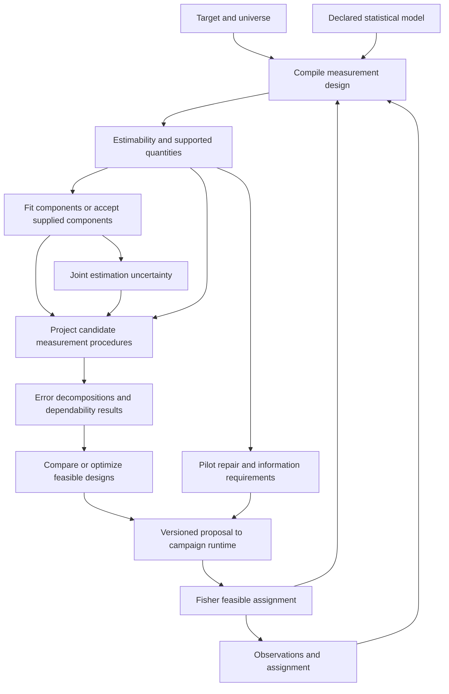

# Crolib measurement design

Overarching design, 2 October 2026. This document proposes crolib's scientific
contracts and architecture, drawing on the acquired G-theory corpus and the
[Measurement Armada sketch](../papers/MEASUREMENT_ARMADA.md). It guides subsequent
mathematical specifications and implementation plans. Proposed capabilities are
distinguished from the published 0.1.0 API throughout.

The architecture received independent reviews of
[scientific semantics](../papers/reviews/armada-design-semantics.md),
[estimation and uncertainty](../papers/reviews/armada-design-inference.md), and
[Armada integration](../papers/reviews/armada-design-architecture.md). Their
architectural findings are incorporated. Family-specific mathematical
specifications and implementation planning remain the next work.

Crolib characterizes the dependability of a measurement procedure under a
declared universe of observations, and evaluates changes to that procedure.
Its central object is a **measurement study**: a target, an observation design,
a sampling universe, a score definition, and a model. Variance components and
coefficients are results within that study.

In the Armada, Cro supplies the conventional computational foundation for
evaluating the observation apparatus and choosing useful replication. A campaign
can ask whether to collect more tasks, judges, occasions, or overlapping ratings;
Cro must explain which proposed improvements the evidence actually supports.
This remains useful with human observers, physical instruments, learned
observers, and conventional inference.

## Scientific responsibilities

Crolib owns G-study design semantics, variance and covariance decomposition,
estimability of dependability targets, relative and absolute measurement error,
G/D-study uncertainty, and projection and allocation under supported replication
models. Objects of measurement may be people, systems, classes, sites, dyads, or
combinations of factors.

Other Armada responsibilities retain distinct contracts:

| Neighbor | Handoff involving Cro |
| --- | --- |
| Fisher | Cro states the effects and precision needed, checks a supplied assignment against its measurement model, and evaluates feasible candidate designs. Fisher constructs assignments, randomization and blocking under operational constraints. |
| Ras | Cro accepts a declared response-model target or explicitly mapped parameter representation. Ras owns response scales, category thresholds, latent-scale difficulty/severity and linking; Cro can retain Gaussian rater mean terms. |
| Shared inference | Cro defines the statistical model and derived dependability quantities. An inference engine estimates the declared model and returns parameterization, constraints, joint uncertainty and diagnostics. |
| GUM | Cro exports measurement-error contributions and covariance with their sampling meaning. GUM combines them with calibration, reference and other uncertainty without counting a contribution twice. |
| Campbell and Box | Cro exports conditional dependability evidence. These neighbors examine interpretation, rival models, simulator discrepancy and adequacy for the intended use. |
| Campaign runtime and acquisition | Cro assesses candidate observation procedures and states supported forecasts or information needs. The runtime selects, executes and records probes, including adaptive selection and stopping. |

Agreement, accuracy, construct validity, probabilistic calibration and causal
identification remain separate targets. A reliable apparatus can share a bias.
Generalization to a declared facet universe carries no automatic claim about
unexamined environments. These boundaries follow Armada pages 3–6 and 8–10;
the packaging and interfaces below are design choices.

## Governing choices

1. **Separate the observed design from the intended universe.** Rows describe
   what was observed; the universe describes what replications the result is
   supposed to cover.
2. **Declare the target before partitioning signal and error.** Stable-trait,
   change-score, ranking, absolute-score and threshold decisions can partition
   the same variation differently.
3. **Check the requested projection.** Confounded components may still support
   some quantities. Unsupported extrapolation must not acquire an estimate merely
   because an optimizer or bootstrap returned numbers.
4. **Preserve estimation semantics.** Signed moment estimates, constrained
   boundary estimates and posterior distributions retain their identities.
5. **Carry joint covariance and uncertainty.** Components, dimensions and
   candidate designs share information; independent marginal summaries lose it.
6. **Expose the calculation's support.** Results state scale, population,
   sampling conditions, assumptions and numerical diagnostics.
7. **Own the machinery.** Reference implementations guide derivations and
   comparisons. This design adopts no external runtime dependency.

The [foundations](../papers/lanes/foundations/report.md),
[estimation](../papers/lanes/estimation/report.md) and
[software audit](../papers/lanes/software/capability-matrix.md) motivate these
choices. They are proposed contracts, rather than claims that every branch has
already received a complete mathematical derivation.

## Architecture



Supplied components enter through the same target, universe and projection
contracts without requiring observations or a fit. They do not acquire
estimation uncertainty unless the caller supplies a coherent uncertainty model.
Compilation and estimability checks can run before data collection.

The proposed Rust organization is `study`, `design`, `model`, `estimate`,
`project`, `uncertainty`, `decision` and `result`, with owned numerical machinery
below them. These are conceptual modules; no package split or public type names
are committed by this document. Thin language interfaces should expose the same
scientific meaning.

## Study and observation records

The minimum vocabulary is deliberately smaller than a complete campaign schema.
Crolib accepts campaign identifiers and evidence references without owning logs,
expert discussion, simulator trajectories or a campaign database.

| Record | Required meaning |
| --- | --- |
| Target | Object factors; population; stable trait, change or other score target; relative or absolute use; score scale and units; conditioning; intended precision. |
| Universe | For each generalized facet: exchangeability or dependence assumptions, finite or infinite population, sampling rule, and fixed levels where applicable. |
| Observed design | Factor identities, scoped level identities, crossing and nesting, actual assignments, replicates and links between score dimensions. |
| Observation | Supported point/category value or interval/censoring bounds, explicit status, dimension and scale, assignment and observer/instrument identities, point time or window with units, protocol and observation-mechanism versions, and evidence/parent references. |
| Score | Mean, total, composite or contrast; aggregation weights and denominator; treatment of missing observations; dimension transformations. |
| Model | Mean structure, random-effect terms and covariance families, residual/dependence structure, observation distribution, parameterization and constraints. |
| Fit or supplied components | Component values or identified combinations with unresolved aliases, source and method, model/scale/universe compatibility, joint uncertainty if available, and diagnostics. |
| Result | Defined quantity, estimate or supported bounds, decomposition, interval semantics, assumptions, applicability and provenance. |
| Proposal | Replication forecast or pilot repair; target study/model version, candidate procedure, costs and constraints, supported prediction or missing information, and selection criterion where supplied. |

Level identity must survive ingestion. A local rater label within a site is
scoped by that site when raters are nested. A recurring global rater has the
same identity across assignments. A rating slot does not become a rater identity.

Missing, not assigned, censored, invalid and abstained are distinct statuses.
None becomes a numerical zero. Selecting a complete-case subset is an explicit
analysis operation with a recorded population change. Planned incompleteness
does not automatically justify incidental or informative missingness.

Protocol and evidence access are part of the observation process. First-pass
ratings and adjudicated ratings retain separate records and roles. Repeated
outputs from one learned observer retain shared model, evidence and exposure
identities. Treating them as independent requires a supported dependence model.
Cro consumes these distinctions; the expert apparatus owns their collection.

An observation-mechanism reference resolves the allowed evidence and visibility
configuration. A censoring status carries its bound, and a windowed observation
carries its window and time units. The first estimator can reject unsupported
record kinds while preserving them for later supported families. An occasion
label alone cannot determine elapsed time or a temporal covariance model.

## Universe and score semantics

Each facet can be held fixed, sampled from a finite universe, or sampled from an
infinite/exchangeable universe. Finite sampling also specifies universe size,
with or without replacement, and selection probabilities where needed. Fixed
levels and a finite random census can have different inferential contracts even
when an averaging term vanishes in both.

Sampling role and statistical model role are separate declarations. A fixed
D-study panel can be evaluated from an all-random G-study under a justified
transformation; that does not mean every fixed panel has a fitted fixed-effect
model. Retained fixed-facet interactions can contribute to universe-score
variation. An implementation must derive this assignment from the target and
sampling rule, rather than remove every term containing a fixed facet.

Define the universe score as the expected score under the specified replication
procedure, conditional on the declared object and retained conditions. The
definition includes score weights, facet selection and protocol. It determines
which component effects survive expectation and which contribute to error.

The object population carries its weighting measure and variance convention:
a superpopulation component and variance across a realized finite panel are
different quantities. Filtering systems or changing group weights can change
the signal variance even with the same instrument. Supported families must
state whether their target is conditional on that panel or a sampled population.

The initial general engine will implement explicit, derived sampling families.
Finite-universe and arbitrary weighted sampling remain separate capability
entries until their transformations are established. There is no general rule
that appends `1 - n/N` to every component.

For multivariate scores, dimensions identify their native metrics and allowable
transformations. A mean, a sum and a half-range contribution have different
weights. Ordinal categories require a declared numerical working score or a
response model. Variance on a logit scale retains that scale until an explicit
model-based mapping is applied.

Sources: Allal's acquired 1986 exposition and Brennan ACT26/CASMA1, summarized in
the [foundations report](../papers/lanes/foundations/report.md); score conventions
and scale bridges in the [multivariate report](../papers/lanes/multivariate/report.md).

## Design compilation and estimability

Compilation resolves factor roles, scoped level identities, nesting relations,
interaction terms, observed incidence, score operators and proposed sampling
operators. It rejects contradictory nesting and assignments, mismatched
dimensions, duplicate observations without replicate identities, and unsupported
model families. A row-order change cannot change the mathematical design.

For the Gaussian random-effects family, the model has the form

```text
y = X beta + sum_e Z_e b_e + epsilon
Cov(y) = sum_e theta_e K_e
```

`K_e` includes the appropriate covariance kernel for each random or residual
effect. The scalar model uses variance parameters; multivariate and structured
models expand the representation while preserving component identity. This
provides a common representation for EMS derivations, likelihood fitting and
projection; it does not imply that these estimators are interchangeable.
The displayed sum assumes independent effect blocks; correlated blocks require
their joint covariance kernels and associated parameters explicitly.

The compiler distinguishes mean-model rank, covariance-component identifiability
and numerical weakness. Connectedness is a useful design diagnostic, but is not
a complete covariance-identifiability theorem. In a restricted-likelihood
analysis, component kernels must be examined after removing the fixed mean
space; an effect with no residual contrast information cannot be recovered by
REML merely because its unprojected kernel is distinct. The exact criterion and
tolerances belong to the estimator-family specification.

An alias report preserves identifiable combinations. In a linear component
moment family `E[t] = A theta`, a requested linear quantity `q' theta` is
identifiable from those moment expectations when `q` annihilates the null space
of `A`. The observed statistics `t` are noisy, rather than exact constraints on
the population parameters. Separately identifying every component is unnecessary
for that quantity. Identification through selected moments, through the full
observation law, and through a REML contrast law have separate scopes. Ratios
and other nonlinear quantities need a corresponding invariance check over the
admissible parameter set; successful evaluation at one arbitrary decomposition
is insufficient.

Fits can retain identified combinations, their joint uncertainty and unresolved
aliases. A supported projection consumes those combinations directly; it must
not require an arbitrary decomposition into individual component estimates.

The result distinguishes a point-identified quantity, a supported bounded/set
quantity, and an unidentified quantity. Bounds require a derived model-specific
procedure. Positivity constraints or priors must not be presented as information
supplied by the observation design. External component information can support
an otherwise unidentified projection when its source and assumptions are explicit.

Brennan's CASMA51, *The Problem of One*, supplies the central example: one prompt
can leave person and person-by-prompt variance confounded. A precision estimate
for that prompt can remain meaningful while projection to new prompts requires
additional information. See the [foundations report](../papers/lanes/foundations/report.md).

## Estimation contracts

Every estimator declares its supported design/model family, estimating
criterion, component parameterization, constraints, termination criteria and
uncertainty methods. The first fitting family should be balanced Gaussian
ANOVA/expected-mean-square estimation. It supplies directly inspectable equations
and published crossed/nested comparisons.

Cro initially owns its G-specific EMS logic and bounded Gaussian fitting engine,
exposed through the reusable model/estimate contract. Shared inference can later
reuse or supply compatible machinery through that contract; each fit has one
responsible implementation and method identity. A joint response/GT model
retains one coherent joint estimation state, including fitted means/effects and
their dependence, rather than combining independent fitted summaries implicitly.

Likelihood estimation then extends supported incidence patterns through an
owned constrained Gaussian engine. REML and ML retain separate method identities.
Boundary zeros and singular covariance require valid parameterizations and
diagnostics. Sparse computation is an engineering capability distinct from
statistical support for missingness or a sampling universe.

Henderson I/II/III, MINQUE and Bayesian families remain named future branches.
An implementation cannot substitute a harmonic cell count or residual-MS
subtraction for a design-specific moment derivation. Bayesian adapters must
preserve prior, likelihood, joint posterior and approximation diagnostics;
the same design can yield different posterior conclusions under different priors.

Signed moment estimates remain available in the raw fit. Projection from them
requires a named policy. The default for a population covariance calculation
rejects inadmissible components; an explicitly requested historical signed
calculation or truncation is labeled and retains the original values. Truncation
and constrained refitting are different procedures. For covariance matrices,
negative off-diagonals may be valid; PSD repair changes the estimate and must
be named rather than performed silently.

Fit diagnostics are separate fields: structural aliasing, numerical convergence,
boundary/singular status, conditioning, and empirical model checks can coexist.
An exact boundary solution can be a successful fit. An optimizer failure cannot
silently switch estimator or return a successful default result.

Singularity of a random-effect covariance is distinct from singularity of the
full observation covariance. The ordinary Gaussian likelihood requires the
latter to be positive definite on its declared observation space. A fit with
singular observation covariance needs an explicitly derived lower-dimensional
model or an unavailable-likelihood result. Adding an undeclared diagonal ridge
changes the model and cannot silently convert that result into a valid fit.

Sources and candidate fixtures are in the
[estimation report](../papers/lanes/estimation/report.md).

## Projection and reported quantities

A D-study proposes a new measurement procedure: counts, assignment topology,
shared versus independently resampled facets, score weights, retained conditions
and selection rules. A count-only request is sufficient for a supported balanced
family. Irregular candidate procedures require actual incidence or a validated
assignment distribution.

Projection verifies compatibility of population, component meaning, scale,
protocol and sampling assumptions. A changed rubric, a different object
population or a new observer family requires an explicit new model or transport
assumption; it cannot be justified by renaming a count. A candidate may be
feasible yet unsupported by the pilot information.

Each candidate declares whether it preserves the target or changes it. Changing
fixed panels, dimension weights, score definitions or the generalized population
can change the universe score itself. Target-preserving replication comparisons
are the default; target-changing comparisons require an explicit criterion and
report both targets. A higher coefficient for a different construct or composite
does not by itself establish improvement in the original measurement task.

Linear score operators and covariance kernels provide the mathematical route
for general projection. If `S` is the observed score and `U` its declared universe
score, absolute error is `S - U`, with covariance

```text
Cov(S - U) = Cov(S) + Cov(U) - Cov(S,U) - Cov(U,S).
```

Relative error removes only the common shifts irrelevant to the declared
comparison. Its operator and population summary must be derived for each
supported score/design family. Unequal precision and correlated object errors
must remain visible; they do not automatically reduce to one balanced scalar G.

Projection retains the mean structure as well as covariance. Under random
assignment or facet selection, total score covariance includes both expected
conditional covariance and covariance of the conditional mean. Fixed item
intercepts can therefore produce sampling error absent from covariance
conditional on one assignment. A covariance-only export is insufficient when
the target depends on these means; response-model bridges additionally retain
the relevant thresholds and links.

For the existing all-random, infinite-universe, balanced crossed
object × item × rater family, the current contract remains

```text
relative_error = object_item/I + object_rater/R + residual/(I R)
absolute_error = relative_error + item/I + rater/R + item_rater/(I R)
G   = object / (object + relative_error)
Phi = object / (object + absolute_error).
```

Here the unreplicated residual combines the three-way interaction and
observational error. A future replicated design can separate them when
identifiable. A projected result reports universe-score variance, each error
contribution, total error, defined coefficient and measurement SEM. A zero
denominator produces an undefined quantity with a reason; it does not produce
a fabricated zero or one. Floating-point overflow and underflow remain part of
the numerical contract, as in the current kernel.

The coefficient family is explicit. Relative G, absolute Phi, cut-specific
squared-error indices, classification consistency and classification accuracy
are separate requests. Threshold probabilities require an additional response,
population and replication model. Conditional SEM also requires its own
derivation; it cannot be inferred from a marginal coefficient alone.

Sources: CASMA1 and the [decisions report](../papers/lanes/decisions/report.md).

## Multivariate and temporal extension

Each effect can contribute a covariance matrix across score dimensions. Linked
facets and independently sampled facets induce different off-diagonal structures.
Different dimensions can have different design topologies, as in mixed-format
tests. The architecture therefore attaches an effect's incidence and linkage to
its covariance contribution instead of requiring one common rectangular cube.

For a declared linear composite with weights `w`, universe-score and error
variances are `w' Sigma_U w` and `w' Sigma_E w`. Mean/total conversions transform
the covariance matrices and weights coherently. A change score is a contrast
with its shared true-score and error covariance, rather than a function of two
marginal reliabilities.

Stable-person averages, occasion-specific states and change across occasions
are different targets. Serial correlation, drift, random slopes and
person-specific error belong to explicitly supported model families. Naming a
factor `time` does not establish exchangeable or independent errors.

This extension is designed into the records now; general multivariate fitting,
heterogeneous designs, conditional precision and ordinal observed-scale
dependability require further derivations before implementation. See the
[multivariate](../papers/lanes/multivariate/report.md) and
[applications](../papers/lanes/applications/report.md) reports.

## Uncertainty contracts

Four quantities have separate representations: measurement error in scores,
sampling uncertainty of estimates, uncertainty in projected designs, and Monte
Carlo error in simulated evaluations. A SEM describes measurement variation;
it is not the standard error of an estimated reliability coefficient.

An uncertainty request names the estimand, method, level, conditioning,
sampling facets, resampling units, replacement rule, component policy and
refitting procedure. Output records the requested and effective method,
successful and failed replicates, interval interpretation and diagnostics.
Unsupported methods fail explicitly rather than silently becoming Wald intervals.

Replicate failures include failed fits, inadmissible component projections,
undefined denominators and unsupported target transformations. Each method
must specify and justify its treatment of these cases. Computing quantiles
only from successful replicates conditions on success; recording a failure
count does not remove that change of target. Without a justified treatment,
the interval is unavailable and the original point result retains its own status.

Joint uncertainty is propagated through each candidate design using the same
component draws or joint approximation. Independent intervals on individual
components do not supply a coefficient interval. Crossed-level bootstrap,
nested-cluster bootstrap, parametric bootstrap, analytic intervals and Bayesian
credible intervals retain distinct contracts and support domains.

A draw collection identifies whether it contains bootstrap estimator replicates,
posterior parameter draws or a named joint approximation. It carries effect and
dimension order, parameterization, scale, constraints and all state needed for
the requested projection, including mean/threshold parameters where required.
An anonymous matrix of marginal variance samples is insufficient. Supplied
uncertainty is accepted only with its construction and conditioning declared.

The number of persons, tasks and raters all affects estimation precision.
There is no universal minimum-person guarantee. Boundary estimates, finite
sampling, near-unity coefficients and singular multivariate covariance require
method-specific treatment. Simulation establishes empirical performance within
its generators, with Monte Carlo precision and failures retained.

Searching many candidate designs and then quoting the selected design's marginal
interval introduces a selection question. Joint draw propagation preserves
dependence, but by itself establishes neither simultaneous frequentist coverage
nor validity under adaptive data collection. Such claims require a separately
derived method. Results state whether an interval concerns a predeclared design,
a marginal evaluation of a candidate, a selected design or a simultaneous
family. An interval unsupported for the requested selection regime is unavailable,
even if a candidate's marginal calculation exists. Sources and known limitations are in the
[uncertainty report](../papers/lanes/uncertainty/report.md).

## Design comparison and acquisition

The initial decision engine evaluates finite candidate sets and bounded integer
allocations. It accepts explicit costs, integer bounds, operational constraints
and a target such as maximum G within budget or minimum cost at required Phi.
Task and judge counts can carry nonlinear and nested costs.

Each candidate has separate feasibility, projection-support and objective
statuses. The result includes attained error/precision, cost, limiting terms,
and the examined search domain. Full enumeration establishes an optimum only
over that declared finite domain. Heuristics and continuous relaxations carry
their corresponding qualifications; rounding requires a fresh feasibility check.

Uncertainty-aware criteria must name their interpretation: a plug-in coefficient
threshold, a lower confidence bound, posterior probability of meeting a target,
or an explicit loss are different objectives. Unsupported uncertainty criteria
cannot fall back to point estimates.

Replication forecasts and pilot repairs have different proposal contracts.
A replication forecast predicts measurement performance from components the
pilot identifies, or from explicitly supplied external information. A pilot
repair proposes observations intended to distinguish previously confounded
components. Cro can check whether its proposed incidence would resolve a
specified alias without claiming a numerical G/Phi improvement. This lets the
campaign seek the very information its current pilot lacks.

Prospective covariance identification is conditional on the stated model and
estimator. A structurally adequate repair is not a guarantee of a precise fit.
Predicting its numerical precision or information utility requires supplied
parameter scenarios, a prior or another declared acquisition model. Information
gain and mechanism discrimination are not quantities defined by G-theory alone.

The handoff is a versioned round trip. Cro emits the target, effect information
needed, proposed counts/topology or assignment law, constraints, costs and
forecast assumptions. Fisher returns an actual assignment and unmet constraints.
Cro re-evaluates the returned incidence and scores before the runtime executes
it; a count forecast cannot certify a changed sparse assignment. The runtime
records the chosen proposal, selection history, completed observations and
stopping decisions. New observations produce a new study assessment and fit;
the prior result remains available with its original support.

The [decisions report](../papers/lanes/decisions/report.md) supplies resource
allocation cases and a printed item/occasion reversal that illustrates why
independent enumeration is valuable.

## Results and Armada interoperability

Result serialization preserves the quantity, native scale, units, target,
population/universe, procedure, model, estimator, component policy, uncertainty
semantics and diagnostics. Stable factor identities and linked evidence references
survive language boundaries. Numeric nulls have typed reasons.

Each fit, result and proposal references the exact versions of its study,
observations/assignment, score, protocol/observation mechanism, model and
estimator configuration. References resolve versioned inputs rather than mutable
latest records. The runtime owns storage and the evidence ledger; Cro's records
contain enough linkage to reconstruct the calculation without owning a database.
Derived or adjudicated observations identify their parents and analysis role.

Covariance and draw exports retain shared stochastic-source identity and joint
draw indexing or approximation identity, including applied transformations.
Two results from one fit remain dependent. GUM handoffs distinguish an individual
component contribution from an already aggregated total, identify shared sources
and supply available cross-covariance; a missing joint relationship cannot be
replaced silently by independence.

An interval records whether it is confidence, credible, prediction or another
defined interval, together with level, construction and conditioning. Evidence
sources distinguish supplied assumptions, synthetic generating parameters,
estimated components, external references and learned approximations. These
follow Armada page 6's distinctions about interval meaning and evidence authority.

Capability checks are compositional: model family, design structure, sampling
rule, score target, estimator, projection and interval method all have to be
supported together. Supporting each feature somewhere in the library does not
promise their arbitrary combination. Unsupported requests identify the specific
missing derivation or implementation.

Learned observers enter as observations with protocol and dependence metadata.
Learned inference enters through the estimator contract with approximation
identity and diagnostics. The conventional engine remains available. A learned
warning or confidence score cannot replace an algebraic estimability check.

Arrow-friendly arrays and compact control records are potential transport
choices, not dependencies selected here. Start with inspectable owned records
and documented array layouts. Prefer a shared Rust scientific implementation
with thin Python access for the larger engine, subject to a separate binding
decision. Any binding or numerical library proposal must receive the workspace's
dependency discussion before adoption.

## Worked campaign

Consider systems scored on tasks by judges. The target is system differentiation
over the declared task and judge universes, using equal-weight average scores.
The supplied-parameter illustration uses the seven nonnegative components from
the existing README:

```text
system = 12; task = 6; judge = 4
system_task = 8; system_judge = 10; task_judge = 2; residual = 24.
```

These are illustrative supplied parameters, not empirical AI results. Under the
current balanced model:

| Tasks | Judges | Ratings per system | Relative error | Absolute error | G | Phi |
| --- | --- | --- | --- | --- | --- | --- |
| 4 | 2 | 8 | 10 | 13.75 | 0.545455 | 0.466019 |
| 8 | 2 | 16 | 7.5 | 10.375 | 0.615385 | 0.536313 |
| 4 | 4 | 16 | 6 | 8.625 | 0.666667 | 0.581818 |

With equal per-rating costs and all assignments feasible, the two 16-rating
designs illustrate a benefit from additional judges. A real recommendation also
accounts for task acquisition, judge recruitment and dependence. With one judge,
the relative coefficient has a limiting value of `12/(12+10) = 0.545455` as task
count grows: the system-by-judge term remains.

Now suppose the pilot assigned each system exclusively to its own judge. The
design does not supply the same decomposition, so the table is unsupported
unless justified external components are supplied. Cro must preserve that
distinction and identify the missing overlap information. A candidate repair
connects judges across systems and tasks; its ability to identify the requested
model must be checked, rather than inferred from overlap alone.

That repair is an information proposal even while its G/Phi forecast is
unavailable. Once the overlapping observations are acquired, a supported fit
can replace the external illustrative parameters and evaluate a replication
proposal. The current release implements only the supplied-parameter arithmetic
in the table.

If judges rate recovery on an ordinal rubric, the campaign must choose and
declare a working score model or a response-model bridge. If judges agree but
misidentify recovery, dependability evidence remains usable while the accuracy
and interpretation questions require independent reference observations.

This illustration motivates the campaign responsibilities in Armada pages 8–12.
It does not demonstrate fitting, interval coverage or a completed acquisition
round trip. Those require the bounded milestone below.

## First bounded campaign

The first end-to-end milestone uses scalar Gaussian ratings in an intended
all-random, crossed system × prompt × judge universe. The initial observations
cover multiple systems and judges on one prompt. They are partial with respect
to prompt coverage; this milestone does not promise arbitrary incomplete-cell
fitting. An unfamiliar instance means new observations and factor identities
within this specified family.

Cro compiles the observed slice and reports the identified component combinations
and supported prompt-conditional results. It preserves the alias that prevents
estimating the intended new-prompt dependability. Its repair proposal requests
a second distinct prompt with the object–judge coverage required by the model.
A conditional result carries its separate target; it cannot replace the blocked
new-prompt answer as a silent fallback.

A small assignment provider returns a concrete design; Cro checks that design
before a minimal runner returns the new observation batch with preserved IDs,
versions and selection history. The expanded balanced design is then fitted
and its newly supported target evaluated.

The mathematical specification must establish which aliases the actual
two-prompt design resolves. Unreplicated interaction/observation aliases may
remain and are preserved. Acquisition is useful when it resolves the information
needed for the requested projection, rather than when every possible component
has been separately estimated.

Acceptance requires actual initial observations, a supported conditional answer,
a blocked new-prompt request, a justified repair, a feasible checked assignment,
a new batch and a refit that changes the supported conclusions. Numerical
comparisons use independently derived balanced examples. Synthetic generating
parameters can supply an oracle but are unavailable to the fit. Negative moment
estimates and any resulting unavailable projection retain their named policies
and reasons.

Prerequisites are study records, balanced effect/alias compilation, balanced EMS
fitting/projection, and the versioned proposal/assignment loop. General sparse
likelihood fitting, intervals, allocation search, multivariate/ordinal/temporal
models and a production campaign database are later capabilities. This milestone
may use an owned assignment provider and small runner; it does not require
launching Fisher or the wider fleet as separate packages. A later milestone
adds a named incomplete Gaussian family and validated uncertainty before
claiming broader partial-rating inference or uncertainty-aware acquisition.

## Capability sequence

This is a dependency map for subsequent specifications, rather than a coding
plan or release promise.

| Capability | Scientific completion condition |
| --- | --- |
| Published 0.1.0 | Already implemented: deterministic supplied-component projection for all-random crossed person × item × rater, independently in Rust and Python. |
| Study semantics and balanced design compiler | Targets, universes, effect terms and aliases have precise rules; crossed/nested primary examples and the current projection are represented without changing their meaning. |
| Balanced G-study fitting and projection | Owned EMS derivations and raw signed estimates match independently reconciled worked examples; supported fixed/finite transformations are enumerated explicitly. |
| First Armada campaign | The bounded one-prompt study retains ambiguity, acquires a checked second-prompt assignment and refits; the round trip preserves target, observation and result semantics. |
| Sparse Gaussian study | A constrained likelihood specification supports stated incomplete designs, preserves aliasing and boundary status, and enables an unfamiliar partial rating experiment with an estimable target. |
| Coherent uncertainty and allocation | At least one supported interval family has justified semantics and demonstrated performance; candidate designs share joint component uncertainty; bounded integer objectives have an independent enumeration oracle. |
| Multivariate and extended models | Linked covariance, composite metrics and contrasts are derived; heterogeneous, temporal and response-scale extensions enter as individually specified families. |

Architectural records should anticipate later covariance and dependence without
claiming those algorithms are present. The published `CrossedComponents` API
remains available with its existing meaning. Future APIs add explicit study
context; converting a legacy input into a study states the assumptions that
the original API already makes.

## Direct validation obligations

The verification strategy attacks distinct fault classes. Its methods become
concrete in each mathematical specification and implementation plan.

| Fault class | Direct mechanism and expected behavior |
| --- | --- |
| Wrong effect algebra or divisor | Hand-derived small crossed/nested EMS and D-study examples with reconciled primary equations; reproduce current exact ratios. |
| Invented information | One-prompt and exclusive system–judge fixtures; retain identifiable combinations and block unsupported projections. |
| Lost identity or incidence | Permute rows/labels; use locally repeated nested labels and globally shared raters; preserve the same mathematical result where identities imply equivalence. |
| Changed statistical procedure | Negative-moment and constrained-zero fixtures; preserve raw values, selected policy and boundary/convergence distinctions. |
| Incorrect covariance or metric | Analytic composite and difference cases, including legitimate negative off-diagonals; transform weights and matrices coherently. |
| Misleading interval or coverage claim | Check the actual target and effective method; use independent simulated datasets with declared generators, failed fits and Monte Carlo error. |
| Wrong allocation | Enumerate a small feasible integer domain independently; check objective direction, costs, support and constraints. |
| Unsupported interpretation or scale | Separate ranking/absolute/classification requests; reject a latent-logit component supplied as raw binary-score variance without a mapping. |
| Shared-error pseudoreplication | Explicit correlated-observer/reference fixtures; additional repeated observations do not average away the shared contribution under the stated model. |
| Numerical or language divergence | Extreme finite inputs, zero denominators and common scientific fixtures across Rust/Python and serialization boundaries. |

Reference outputs are usable only after reconciling version, model, estimator,
constraints and printed precision. Wrappers around one backend supply one
computational lineage. The [software audit](../papers/lanes/software/capability-matrix.md)
identifies candidates and limitations. Formal models may help design compilation
and projection eligibility; they should express those rules directly, without
duplicating every numerical algorithm in a second specification engine.

## Mathematical work still required

The architecture is sufficiently defined to pressure-test its boundaries.
Implementation specifications still need primary derivations for:

- Balanced crossed/nested effect enumeration and alias-preserving EMS systems,
  including the exact supported fixed-facet and finite-universe transformations.
- Covariance identifiability under each estimator, nonlinear projection
  eligibility, and any partial-identification bounds offered to callers.
- Irregular score operators, unequal precision and dependence; constrained
  likelihood boundary handling and meaningful diagnostic tolerances.
- Linked multivariate covariance, heterogeneous designs and mean/total/contrast
  transformations, including required mean information for absolute targets.
- Interval methods at boundaries and under finite or incomplete sampling,
  uncertainty after design selection, and adaptive acquisition assumptions.
- Observed-scale categorical projection, conditional precision and
  classification models before those capabilities are advertised.

The [shopping list](../papers/SHOPPING_LIST.md) includes the missing foundational
monographs and corrections. Available ACT/CASMA reports and acquired modern
papers allow bounded specifications to advance; missing originals do not justify
claiming a universal compiler or estimator. Binding technology, cross-library
schema extraction, and a shared numerical package remain engineering decisions
to make through the first supported campaigns.
